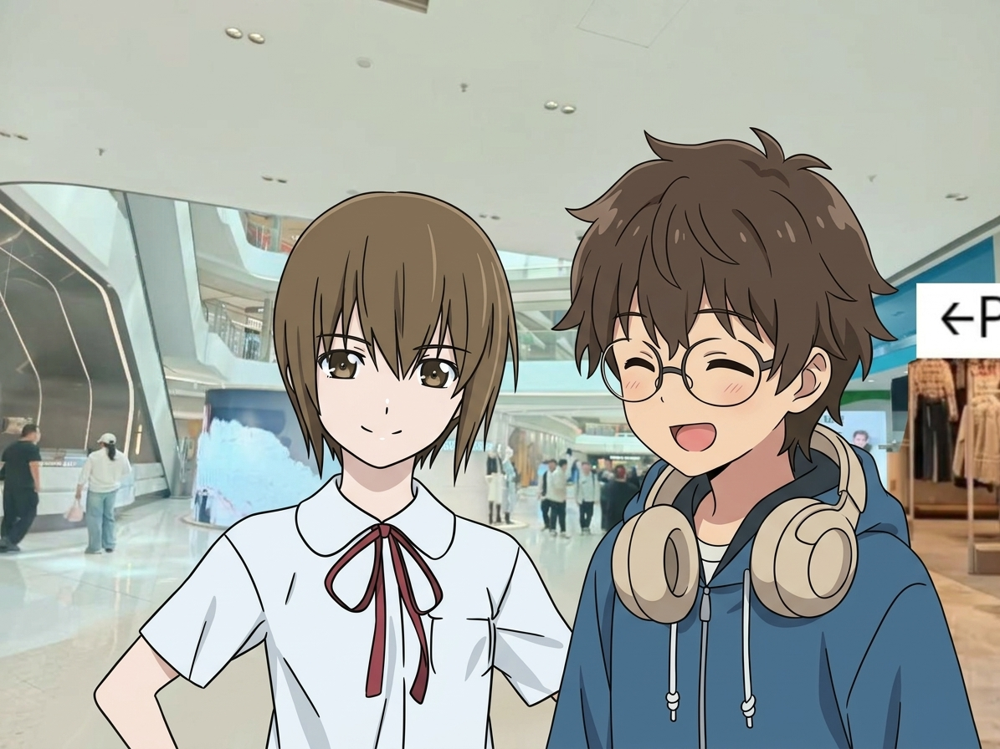
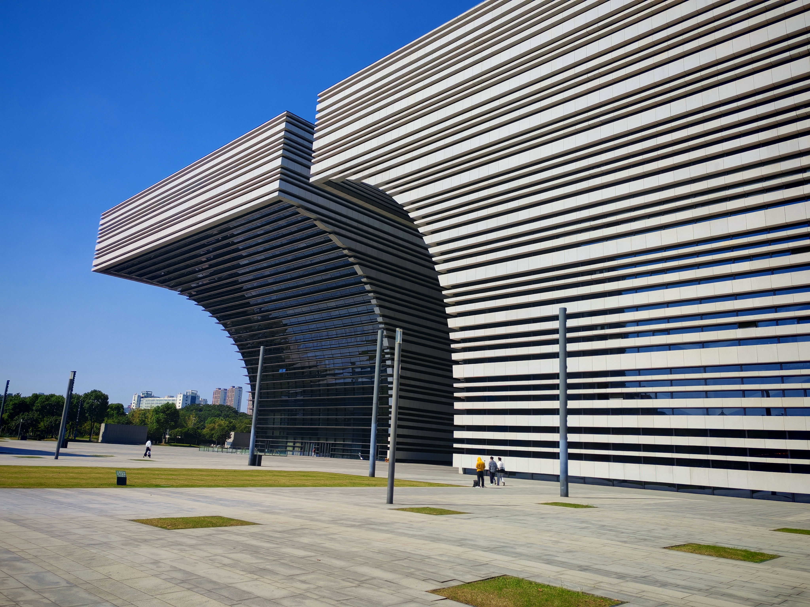
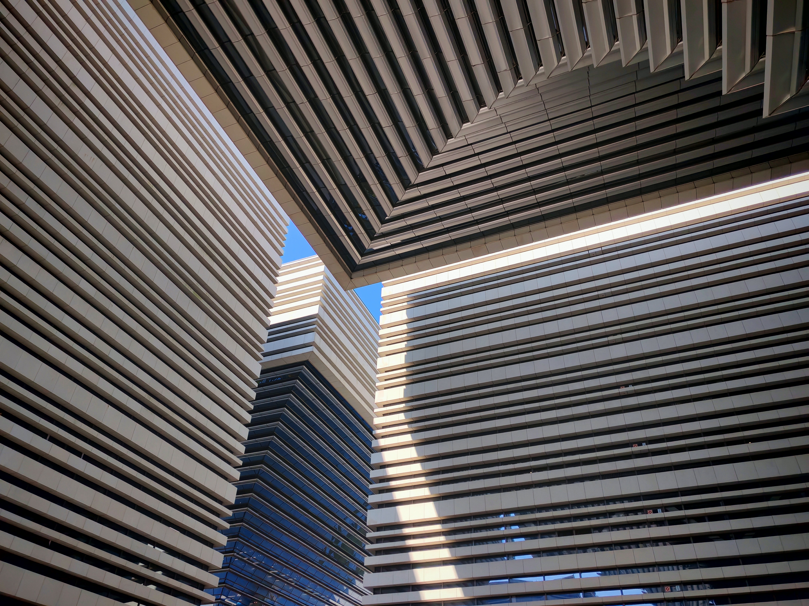
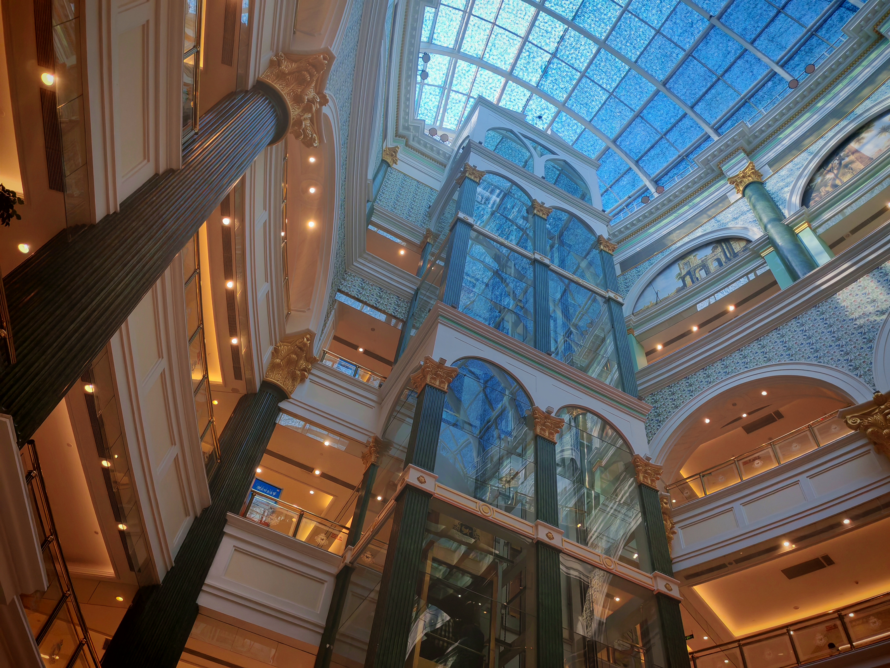
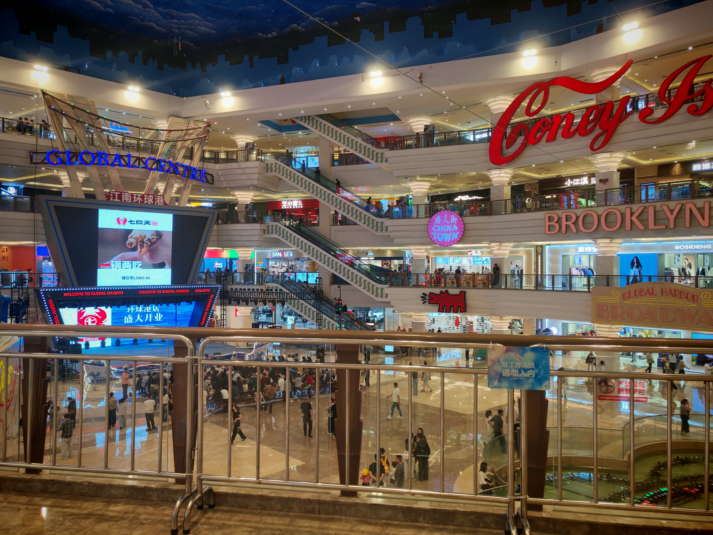
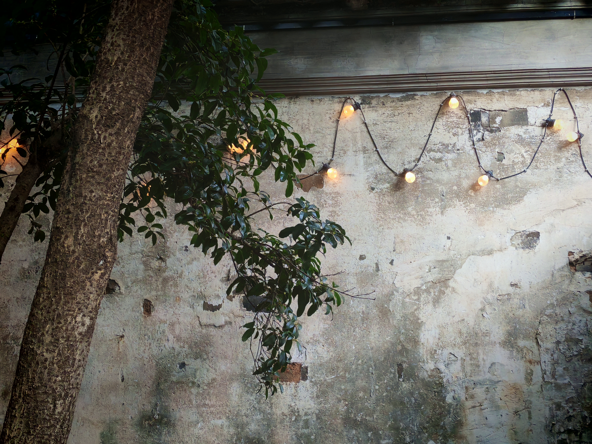
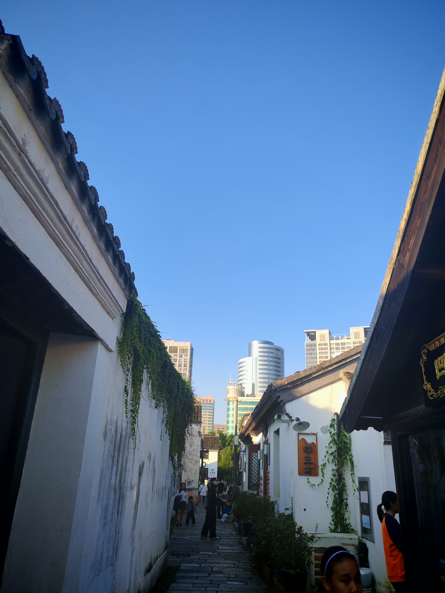
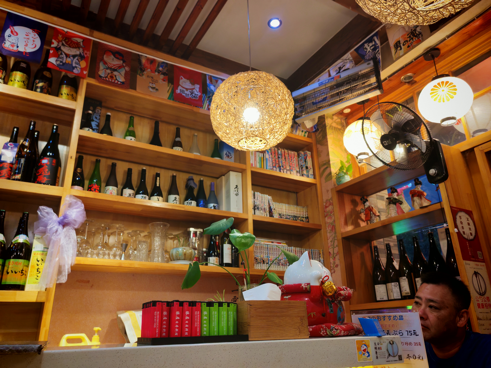
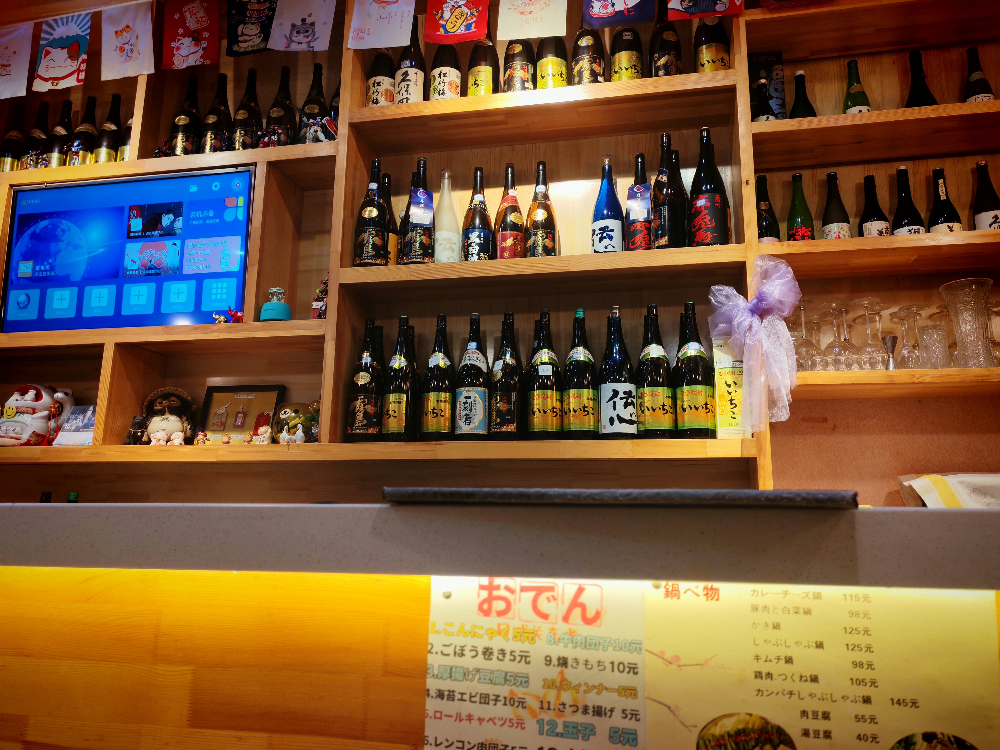

哈哈君是一位来自苏州的朋友，接受了我的邀请，准备在国庆节与我面基，顺带着来到常州玩一玩。

而我刚刚才结束糟糕的蚌埠之旅，精疲力竭，甚至前一天才吃了感冒药，但我也很期待面对这种反差，经过讨论后，我们便在中午的万象城见面。

## 万象城

这是我们见面的场所，也是常州最好的商场，但他似乎不太喜欢这里，于是我们在这里吃了个午饭，便离开了。

## 市民广场

下一站是市民广场，这里是常州的地标建筑之一，同样地草草略过了一下，到现在我才明白我可能以自己的偏好来规划地点了，可能不符合他的口味。

稍微在这里逗留了一下，拍了几张照，就离开了。

## 环球港

也许实在是太走马观花了，到现在所花费的时间比我预料短的多，于是我带他去常州最大的商场。

这个商场采用中世纪风格，被他戏称为“洗脚店”——好像还真是呢，不过看久了居然还能品味出另类的美感，~~我简直是没救了~~。

我们的关系也是从这里开始破冰的，一起讨论了博客和AI创作，还稍微透露了一下我对自己新小说的想法。

## 青果巷

到这里我才发现我又犯了个错：我似乎只想着要玩什么地点，忘掉了怎么排更顺路，导致我们必须折返地去青果巷，逛完后去汉江路还必须折回来。

不过富有人文气息的地方他比较喜欢，虽然这里很吵，但是交流得更深入了，互相分享了难懂的诗篇，互相了解了学日语的经历，还说了一下我对于日本的计划。

## 汉江路

终于到了傍晚，我们准备在汉江路吃饭，顺带讲了讲苏州淮海街的一些事情。

在等餐的过程中，还让他看了看我的NinoClaw项目，试图找出速度慢的原因，也指出了双脑机制的弊端。

还发生了个小插曲，因为上菜的时间有点慢，我便稍微提醒了一下，结果坐在我左边的日本人似乎用肢体语言向我表达什么，但是我没能理解，是不要催促吗？

## 结束

吃完饭后还有一点点时间，去万达打了一局太鼓，便告别了。