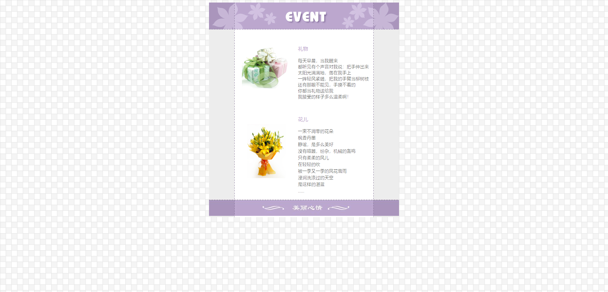

这是老师发我的一份作业，需要按照效果图复刻同样的页面出来：



但对于我而言，这效果实在是太复古了，实现起来也很简单，我并不想浪费时间在这上面。

但是我转念一想，假如我用Astro或jQuery来实现呢？也许可以尝到不同的感觉，于是便用了jQuery。

技术上不难，但是不再用更方便的标记语言写，而是直接操作DOM：创建每个标签及其属性，然后挂载到需要挂载的地方（根挂载点就是`body`）。

```html
<script src="https://cdnjs.cloudflare.com/ajax/libs/jquery/4.0.0/jquery.min.js"></script>
<script>
    $(function(){
        $('<h1></h1>').appendTo('body')
            .text('Hello')
    })
</script>
```

有了以上的大体框架，我们就可以把整个页面写出来了：

```html
<script src="https://cdnjs.cloudflare.com/ajax/libs/jquery/4.0.0/jquery.min.js"></script>
<script>
    $(function(){
        let text1_context = `
每天早晨，当我醒来，
都听见有个声音对我说：把手伸出来。
太阳光满满地，落在我手上。
一阵轻风紧随，把我的手臂当柳树枝。
还有那眼不能见，手摸不着的，
你都当礼物送给我。
我接受的样子多么温柔啊！`

        let text2_context = `
一束不凋零的花朵  
枫香丹墨  
静谧，是多么美好  
没有喧嚣，纷杂，机械的轰鸣  
只有柔柔的风儿，
在轻轻的吹  
被一季又一季的风花雪雨
浸润洗涤过的天空  
是这样的湛蓝
……`

        $('body')
            .css('background-image', 'url("./images/background.gif")')

        $('<div></div>').appendTo('body')
            .addClass('main')
            .css('margin', 'auto')
            .css('width', '600px')

        $('</img>').appendTo('.main')
            .attr('src', './images/table_top.jpg')

        $('<div></div>').appendTo('.main')
            .addClass('content-div')
            .css('background-image', 'url("./images/table_bg.jpg")')
            .css('padding', '40px 120px 40px 120px')
            .css('height', '350px')
        
        $('</img>').appendTo('.content-div')
            .addClass('text-img')
            .attr('src', './images/table_img1.jpg')

        $('<h3></h3>').appendTo('.content-div')
            .text('礼物')
            .addClass('title')
        
        $('<pre></pre>').appendTo('.content-div')
            .text(text1_context)
            .css('font-size', '10px')

        $('</img>').appendTo('.content-div')
            .addClass('text-img')
            .attr('src', './images/table_img2.jpg')

        $('<h3></h3>').appendTo('.content-div')
            .text('花儿')
            .addClass('title')
        
        $('<pre></pre>').appendTo('.content-div')
            .text(text2_context)
            .css('font-size', '10px')
        
        $('.title')
            .css('color', 'slateblue')
            .css('font-size', '20px')
            .css('margin-bottom', '-18px')

        $('.text-img')
            .css('width', '180px')
            .css('float', 'left')
            .css('margin-right', '10px')

        $('</img>').appendTo('.main')
            .attr('src', './images/table_bottom.jpg')
            .css('clear', 'both')
    })
</script>
```

实际运行效果也很还原：

